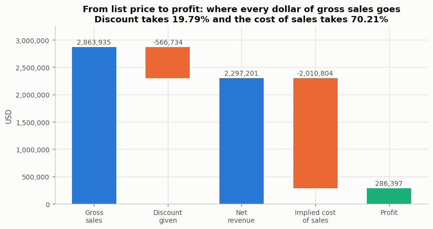
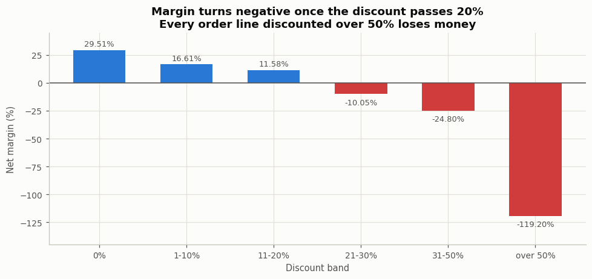

# Financial Performance & Business Intelligence Analytics

**Project owner and author: Pranit Ajay Chaudhari** — BBA student (Finance and Marketing), with
Python and SQL as technical skills. **Project 4** of my analytics portfolio.

> **9,994 order lines · 5,009 orders · 48 continuous months · $2.86M gross sales · $2.30M net revenue**
> Python · MySQL · Excel
>
> **18.72% of order lines are sold below cost**, and margin turns **negative above a 20% discount**.



---

## 1. Business problem

A business can grow revenue and still be going backwards. Revenue is visible to everyone; the money
that leaks out between the list price and the bank account usually is not. This project takes four
years of order-line data and answers the question a finance manager actually has to answer: **of
every dollar we invoice, where does it go, and which parts of the business are not paying their
way?**

The deliverable is a set of financial KPIs, a cost structure, a profitability breakdown by product
and region, and a short list of things management should look at first — each supported by a figure
that can be traced back to the data.

## 2. Objectives

1. Establish the financial structure: gross sales, discount, net revenue, cost of sales, profit.
2. Measure profitability by product category, sub-category, region, state and period.
3. Quantify what discounting costs and find the point at which it stops paying.
4. Identify the parts of the business that lose money, specifically enough to act on.
5. Test whether revenue has a genuine seasonal pattern rather than assuming one.
6. Build a KPI set a manager could run monthly, and verify every figure in three tools.

## 3. Dataset

| | |
|---|---|
| **Name** | Sample — Superstore |
| **Publisher** | Tableau Software (sample content) |
| **Source** | `https://public.tableau.com/app/learn/sample-data`; the copy used was obtained from the public GitHub repository `subhas07/superstore-sales-analysis` |
| **Rows / columns** | **9,994 order lines**; 21 columns as published, 20 after the privacy step |
| **Period** | 3 Jan 2014 – 30 Dec 2017 — **48 continuous months, no gaps** |
| **Scope** | 5,009 orders · 1,862 products · 3 categories · 17 sub-categories · 4 US regions · 49 states |
| **Key fields** | Sales (net revenue), Quantity, Discount, Profit, plus product, segment and geography |
| **Integrity** | SHA-256 `58fb59c6…`; byte-identical to a copy in a second unrelated repository |

Full provenance, licence, field list and the fields it does **not** have:
[`data/raw/README.md`](data/raw/README.md).

### Why this dataset, and what was rejected

A larger candidate (DataCo Smart Supply Chain, 180,519 rows) was profiled first and **rejected**: its
time axis is partitioned by market, so most months contain only one market and a month-on-month
revenue series would measure the file's structure rather than the business. The evidence is in
[`docs/METHODOLOGY.md`](docs/METHODOLOGY.md).

### Dataset limitations

**This is sample data for a fictional retailer, not a real company's accounts.** Every figure here
is computed honestly from the file and nothing is invented, but the findings demonstrate method
rather than describing a real firm. Beyond that: **no operating expenses, overheads, payroll or
tax**, so no operating margin, EBITDA or accounting net profit appears anywhere; **no unit cost**,
so cost is only recoverable as a residual; **no returns** and **no budget**. Full list:
[`docs/LIMITATIONS.md`](docs/LIMITATIONS.md).

## 4. Tools

| Tool | Role |
|---|---|
| **Python 3** (pandas, numpy, matplotlib, openpyxl) | cleaning, validation, all financial calculations, charts, verification |
| **MySQL 8 / MariaDB** | a 4-table star schema and 16 business queries using multi-table joins, CTEs and window functions |
| **Excel** | a 10-sheet analytical workbook that recomputes the headline figures independently, entirely in formulas |

**No Power BI.** Power BI Desktop is Windows-only and could not be created or verified in the
environment this was built in. Rather than ship files, DAX or screenshots nobody has checked, it is
not part of this project in any form.

## 5. Methodology

Full detail in [`docs/METHODOLOGY.md`](docs/METHODOLOGY.md). In brief: clean and validate, derive the
financial fields from stated formulas, compute every ratio as a **ratio of sums** rather than an
average of ratios, round half-up so SQL and Python agree exactly, and verify all three tools against
each other.

## 6. Data cleaning

The file is in good condition and **no rows were removed**. Checked and found: 0 missing values,
0 duplicate Row IDs, 0 unparseable dates, 0 ship dates before their order date, 0 non-positive sales
or quantities, 0 discounts outside [0, 1). Dates were parsed with an explicit `M/D/YYYY` format
rather than letting pandas guess. Every step is logged in `data/cleaned/cleaning_log.csv` and
written up in [`docs/DATA_CLEANING.md`](docs/DATA_CLEANING.md).

**Privacy:** the published file carries a `Customer Name` column with 793 personal names. This
project never analyses individual people, so `python/00_prepare_raw.py` removes it and then re-scans
every cell for emails and phone numbers before allowing the file to be committed.

## 7. KPI definitions

Every derived metric, stated once so there is no ambiguity:

| KPI | Formula | Status |
|---|---|---|
| Net revenue | the dataset's `Sales` | given |
| Profit | the dataset's `Profit` | given |
| Gross sales (list value) | `Sales / (1 − Discount)` | derived |
| Discount value | `GrossSales − Sales` | derived |
| **Implied cost of sales** | `Sales − Profit` | derived — a **residual**, not a reported cost line |
| Net margin | `Profit / Sales` | derived |
| Cost-to-revenue ratio | `ImpliedCost / Sales` | derived |
| Discount rate | `Σ DiscountValue / Σ GrossSales` | derived |
| Average order value | `Σ Revenue / distinct orders` | derived |
| Profit per order | `Σ Profit / distinct orders` | derived |

**Deliberately absent:** gross profit, net profit in the accounting sense, operating margin and
EBITDA. The dataset has no operating expenses, so none of those can be computed and none is
estimated.

## 8. Analysis performed

Revenue performance (total, monthly, quarterly, yearly, growth, by category, by region,
concentration, AOV) · profitability (by category, sub-category, region, state, segment, over time) ·
cost structure and cost trend · discount and margin · business KPIs · a tested seasonality pattern ·
revenue/margin quadrants · loss-making products, sub-categories and states.

## 9. Key findings

| | Finding | Figure |
|---|---|---|
| 1 | **Margin turns negative above a 20% discount** — and every line discounted over 50% loses money | 29.51% margin at no discount → −119.20% above 50% |
| 2 | **Almost one order line in five is sold below cost** | 1,871 of 9,994 lines, giving back **−$156,131** |
| 3 | **Furniture is a third of revenue and a sixteenth of profit** | 32.30% of revenue, 6.44% of profit, **2.49% margin** |
| 4 | **Three sub-categories lose money outright** | Tables −8.56%, Bookcases −3.02%, Supplies −2.55% |
| 5 | **Six sub-categories carry 60% of revenue at a 5.35% margin** | 1,393,384 of revenue in the weakest quadrant |
| 6 | **The region that discounts most earns least**, in perfect inverse order | Central: 24.56% discount → 7.92% margin; West: 15.55% → 14.94% |
| 7 | **Ten states lose money, all discounting at least 29%** | combined **−$98,247**; four states are 71% of it |
| 8 | **Revenue grew 14.83% a year while margin stayed flat** | cost grew 21.31% in 2017 against revenue's 20.36% |
| 9 | **Three months beat their own year's average, every year** | Sep, Nov, Dec above; Jan, Feb, Apr, Jun, Jul below |
| 10 | **133 of 1,862 products produce half of all revenue** | 301 products (16.17%) lose money |



## 10. Business implications

1. **Cap discretionary discounting at 20%.** The break-even point is measured, not assumed, and it
   is the single largest identified drain.
2. **Flag below-cost lines before the order is confirmed**, not in the monthly report.
3. **Reprice Tables and Bookcases** — both are discounted past break-even.
4. **Ask Central region why its discount rate is 9 points above West's.**
5. **Review the four states carrying 71% of state-level losses.**
6. **Decide whether Furniture is a deliberate traffic-builder**; if it is, budget its margin.

Reasoning, with the finding separated from the interpretation in each case:
[`docs/BUSINESS_INSIGHTS.md`](docs/BUSINESS_INSIGHTS.md).

## 11. Project structure

```
Project-4-Financial-Performance-Analytics/
├── README.md · RESUME_BULLETS.md · LICENSE · requirements.txt · .gitignore · run_all.sh
├── data/
│   ├── raw/        sample_superstore.csv + README.md (source, licence, SHA-256, limitations)
│   └── cleaned/    superstore_clean.csv, cleaning_log.csv
├── python/
│   ├── 00_prepare_raw.py     one-time privacy step: removes the personal-name column
│   ├── 01_clean_data.py      validation, derived financial fields, full cleaning log
│   ├── 02_analysis.py        the financial analysis -> outputs/csv/
│   ├── 03_build_charts.py    10 charts -> outputs/charts/
│   ├── 04_run_sql.py         builds the database, runs all 16 queries, exports results
│   ├── 05_build_excel.py     the analytical workbook
│   ├── 06_verify.py          cross-tool verification (0 pass · 1 disagree · 2 cannot verify)
│   └── 07_recalc_excel.py    evaluates the workbook's formulas via LibreOffice
├── sql/
│   ├── schema.sql · analysis_queries.sql
│   └── query_results/        q01 … q16 CSV outputs
├── excel/Financial_Performance_Analytics.xlsx
├── outputs/
│   ├── csv/                  21 result tables - every figure quoted anywhere
│   └── charts/               10 charts
└── docs/   METHODOLOGY · DATA_CLEANING · BUSINESS_INSIGHTS · VERIFICATION
           LIMITATIONS · DIFFERENTIATION · FINAL_AUDIT
```

## 12. Reproducing it

Run this from a fresh extraction — it is the workflow the project is tested against.

```bash
cd Project-4-Financial-Performance-Analytics
pip install -r requirements.txt

bash run_all.sh                       # prepare → clean → analyse → charts → Excel → recalc → verify

# to rebuild the database as well, supply credentials:
MYSQL_USER=root MYSQL_PASSWORD=... bash run_all.sh
```

`run_all.sh` ends by running the verifier and printing its result. The SQL step is skipped with a
clear message if no credentials are supplied, and the committed query results are used for
verification instead. The Excel recalculation needs LibreOffice on `PATH`; if it is absent the
script says so and the verifier reports its Excel checks as **NOT RUN** rather than as a failure.

## 13. Verification

**94 of 94 cross-tool checks pass.** Python, MySQL and Excel are checked against each other rather
than assumed to agree — the workbook recomputes every headline figure with its own formulas, so a
disagreement would surface rather than hide.

```bash
python python/06_verify.py     # exit 0 = all agree · 1 = a figure disagrees · 2 = Excel not recalculated
```

Two real defects were caught this way and fixed in the code: two cost-structure row labels beginning
with `=` were being parsed as formulas and wrote `#VALUE!` into the workbook, and a distinct-order
count written as an array formula would have taken ~100 million operations to recalculate. Details:
[`docs/VERIFICATION.md`](docs/VERIFICATION.md). The repository-level audit, including a
clean-extraction rebuild, is in [`docs/FINAL_AUDIT.md`](docs/FINAL_AUDIT.md).

## 14. Limitations

Summarised in section 3 and set out in full in [`docs/LIMITATIONS.md`](docs/LIMITATIONS.md). The two
that most constrain the conclusions: **this is sample data, not a real company's accounts**, and the
dataset has **no operating expenses**, so nothing here says whether the 12.47% net margin survives
the cost of running the business.

## 15. How this differs from Projects 1, 2 and 3

Projects 1, 2 and 3 all state in their own documentation that they **cannot measure profitability** —
their datasets carry no cost. This project is built on exactly that axis: cost structure, margin,
discount break-even and contribution. Full comparison, written after reading their actual files:
[`docs/DIFFERENTIATION.md`](docs/DIFFERENTIATION.md).

---

*Author: Pranit Ajay Chaudhari. The dataset is not my work; it is Tableau sample content, credited
in [`data/raw/README.md`](data/raw/README.md).*
